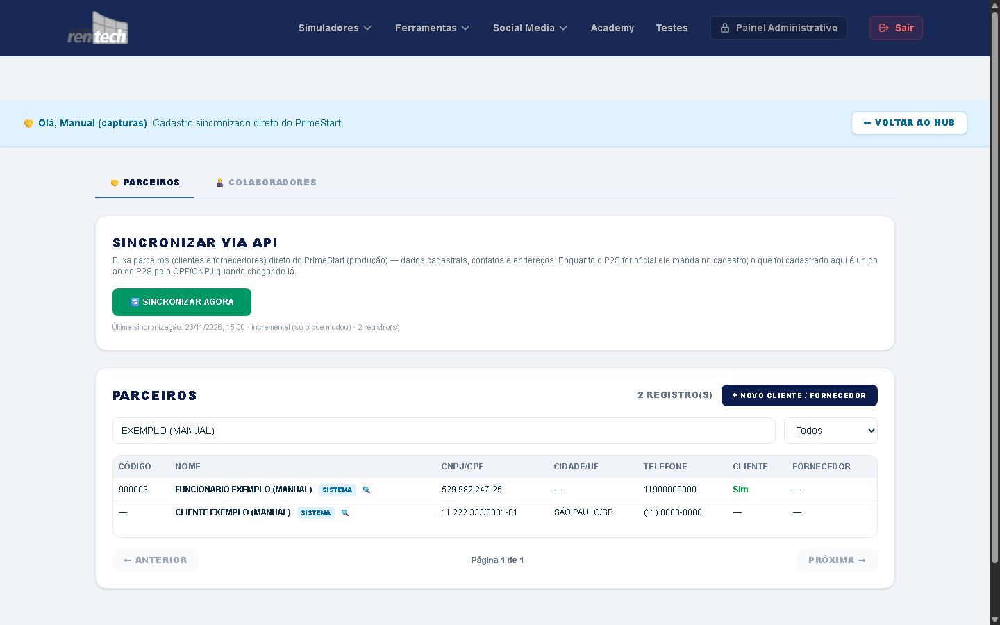
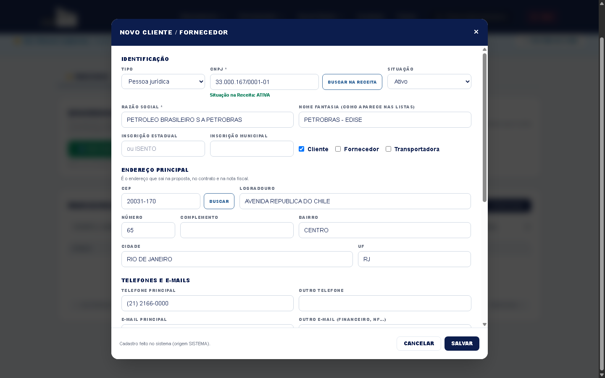
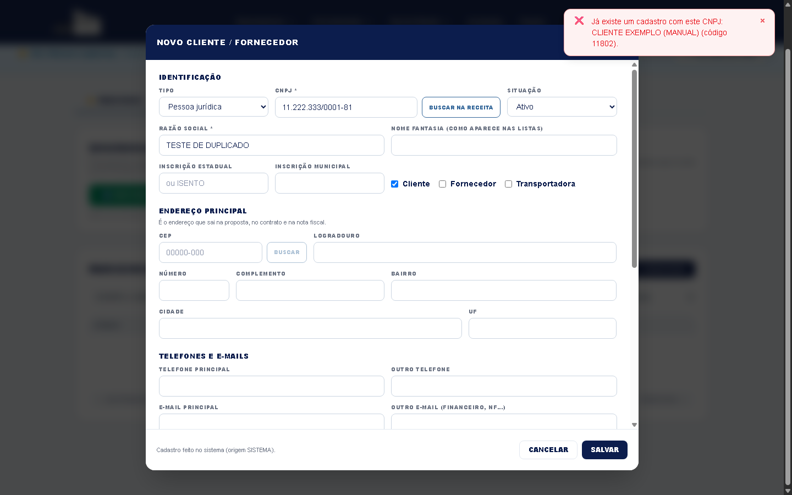
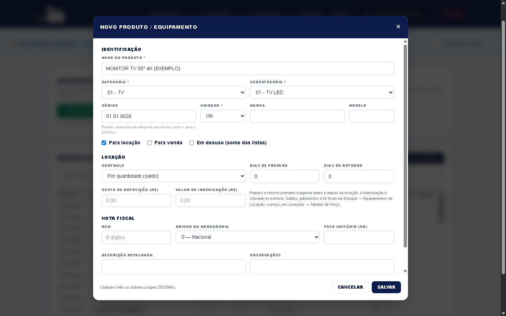
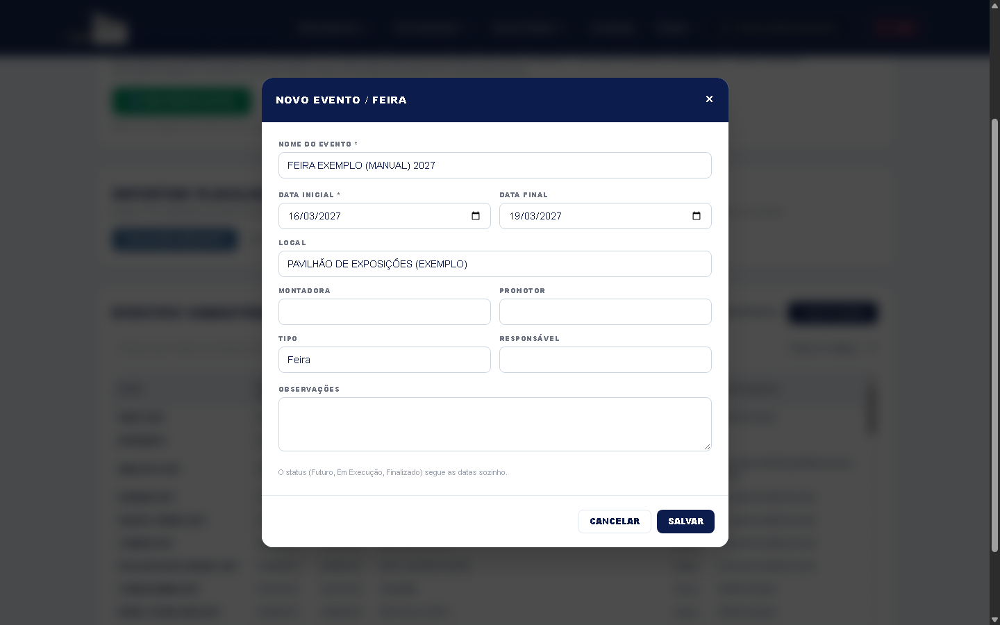
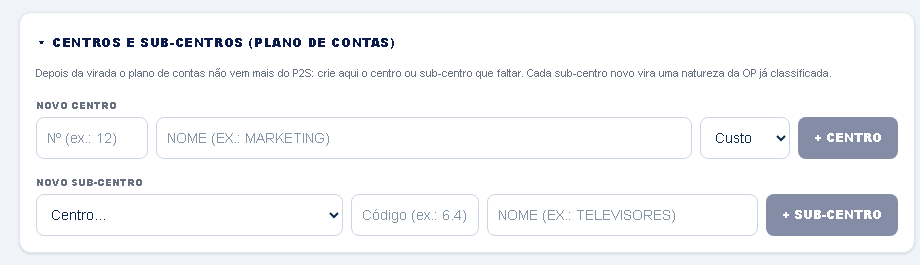
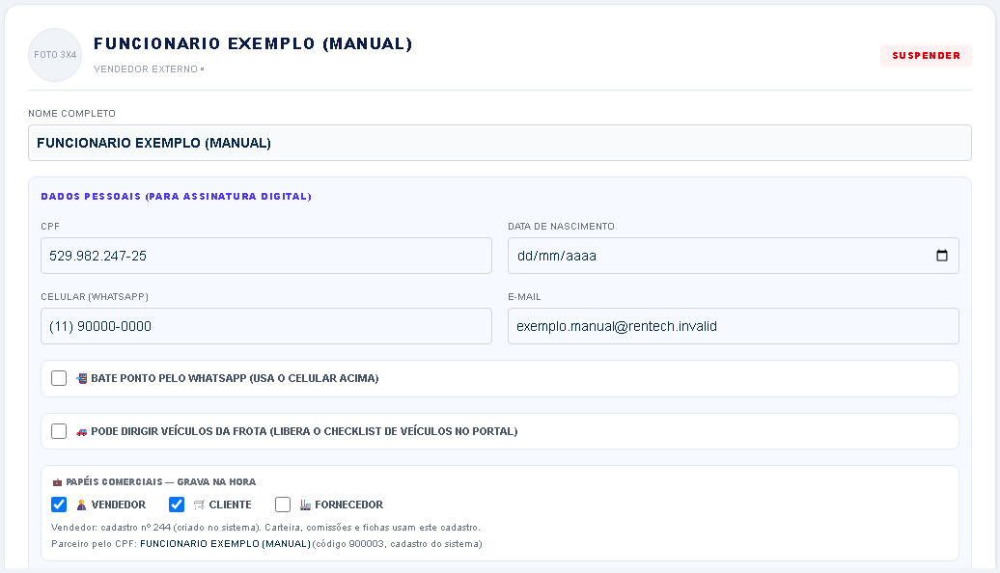

# Cadastros do sistema

## Visão geral

Os cadastros que vinham do P2S agora também podem ser feitos no próprio sistema: clientes e fornecedores, produtos, eventos e feiras, e o plano de contas (centros e sub-centros). Quem é vendedor passa a ser marcado na Ficha do RH.

As telas deste manual são do sistema real, em 23/11/2026, com cadastros fictícios (CLIENTE EXEMPLO e FUNCIONARIO EXEMPLO). Os formulários de produto e evento foram preenchidos só para a foto, sem salvar.

| Cadastro | Onde fica | Botão | Chave contra duplicado |
| --- | --- | --- | --- |
| Clientes e fornecedores | Comercial → Parceiros | + Novo cliente / fornecedor | CPF ou CNPJ |
| Produtos e equipamentos | Estoque → Produtos | + Novo produto | Código (categoria.subcategoria.sequência) ou nome |
| Eventos e feiras | Comercial → Eventos e Feiras | + Novo evento | Nome + data inicial |
| Centros e sub-centros | OP → Natureza & Classificação Financeira | + Centro / + Sub-centro | Código do centro ou do sub-centro |
| Vendedor, cliente e fornecedor do funcionário | RH → Ficha do Funcionário → Papéis comerciais | Marcar a caixa | CPF da ficha |

## Antes e depois da virada

O P2S continua oficial até a virada da chave. Por isso a regra muda conforme a fase:

- **Antes da virada:** já dá para cadastrar aqui. O cadastro nasce com origem **SISTEMA**. Se depois o mesmo cliente, produto ou evento for cadastrado no P2S, a sincronização **adota** o cadastro daqui (pela chave da tabela acima) em vez de criar outro. O cadastro mantém o mesmo número e passa a seguir o P2S.
- **Cadastros que vieram do P2S** ficam só para leitura enquanto o P2S for oficial. Altere no P2S; a mudança chega aqui na sincronização das 11h e das 17h. A exceção é a carteira do vendedor, que pode mudar sempre.
- **Depois que todas as empresas congelarem o P2S:** o sistema vira a origem de todos os cadastros. Tudo pode ser editado aqui e a sincronização de cadastros para.
- **Quando todas as empresas concluírem a virada:** a ligação com o P2S desliga de vez. Qualquer tentativa de falar com o P2S avisa "P2S desligado" e as rotinas automáticas do P2S deixam de rodar.

## Clientes e fornecedores

**Onde fica:** Comercial → Parceiros, botão **+ Novo cliente / fornecedor**. Clicar num parceiro da lista abre o mesmo formulário para editar. O selo SISTEMA marca o cadastro feito aqui.

1. **Tipo:** Pessoa jurídica ou Pessoa física, e os papéis (cliente, fornecedor, transportadora).
2. **CNPJ ou CPF:** é a chave do cadastro. Se já existir um cadastro com o mesmo documento, o sistema não salva e mostra o nome e o código do que já existe.
3. **Buscar na Receita** (pessoa jurídica): preenche razão social, nome fantasia, endereço e telefone pelo CNPJ. Confira antes de salvar.
4. **Endereço principal:** ao digitar o CEP, logradouro, bairro, cidade e UF vêm sozinhos. É o endereço que sai na proposta, no contrato e na nota fiscal.
5. **Telefones e e-mails:** o e-mail principal (ou o de um contato) é com o que o cliente entra no Portal do Cliente.
6. **Contatos e outros endereços** (entrega, cobrança): botões **+ Contato** e **+ Endereço**.
7. **Situação:** Ativo ou Bloqueado. Bloquear pede o motivo.

8. **Carteira do vendedor:** o vendedor responsável pelo cliente. O vendedor só vê e atende os clientes da carteira dele; sem carteira, o cliente entra na carteira de quem fizer a primeira ficha.

**CNPJ ou CPF repetido:** o sistema não salva e diz qual cadastro já usa o documento.

## Produtos e equipamentos

**Onde fica:** Estoque → Produtos, botão **+ Novo produto**.

- **Categoria e subcategoria:** escolha da lista ou crie com **+ Nova categoria…** e **+ Nova subcategoria…** (no formato "NN - NOME").
- **Código:** segue o padrão do P2S, categoria.subcategoria.sequência (ex.: 11.02.0003). Deixe vazio para o sistema gerar o próximo da subcategoria.
- **Nome, unidade, marca e modelo:** o nome é a outra chave contra duplicado.
- **Para locação / Para venda**, e **Em desuso** (some das listas).
- **Controle:** Por quantidade (saldo) ou Por patrimônio (cada peça com número e QR).
- **Dias de preparo e de retorno:** prendem a agenda antes e depois da locação.
- **Valor de indenização:** é o que se cobra no extravio. O custo de reposição fica ao lado.
- **Nota fiscal:** NCM, origem da mercadoria e peso.

Saldos, patrimônios e kits continuam em Estoque → Equipamentos de Locação; o preço, em Locações → Tabelas de Preço.

### Três telas, três papéis

| Tela | Para que serve | Vale para reservar? |
| --- | --- | --- |
| Estoque → Produtos | O catálogo: o que se aluga ou vende, com código, categoria e dados da nota | É a lista que aparece no orçamento, na ficha e na OS |
| Estoque → Equipamentos de Locação | Quanto existe de cada produto, por quantidade ou por patrimônio | Sim: a disponibilidade da reserva sai daqui |
| Estoque → Controle de Estoque | Ficha técnica (peso, consumo, medidas), simulador de videowall e acessórios sugeridos na Expedição | Não |

### Ligar o Controle de Estoque a Produtos

**Onde fica:** Estoque → Controle de Estoque, aba **🔗 Ligar a Produtos**.

Cada equipamento da ficha técnica deve apontar para o produto do catálogo. Assim o primeiro inventário parte de uma lista só, e a Expedição sugere os acessórios também para os itens que vêm da OS.

- **Sugestões:** cada equipamento mostra até 3 produtos de nome parecido, com a nota de semelhança. Verde (80% ou mais) costuma ser o mesmo item; confira os amarelos.
- **Ligar sugestões fortes:** liga de uma vez os que têm sugestão de 80% ou mais sem empate com a segunda.
- **Outro produto…:** escolha pelo código ou pelo nome.
- **＋ Criar produto:** cria o produto com o nome, a categoria e a subcategoria escolhidos e já liga. Só aparece para quem também acessa Estoque → Produtos.
- **Não é item de locação:** para o que não se aluga (cabo de configuração, material de uso interno).
- **Desfazer:** volta o item para pendente.

A "qtd antiga" é a contagem que existia no Controle de Estoque. Serve só de referência: a contagem que vale é a do inventário, em Equipamentos de Locação.

## Eventos e feiras

**Onde fica:** Comercial → Eventos e Feiras, botão **+ Novo evento**. Clicar num evento da lista abre para editar.

- **Nome do evento** e **Data inicial** são obrigatórios. Nome + data inicial não pode repetir.
- **Data final, local, montadora, promotor, tipo e responsável** completam o cadastro.
- **Status:** Futuro, Em Execução ou Finalizado segue as datas sozinho e é recalculado todo dia.

O evento cadastrado aqui já aparece no orçamento da locação e na Expedição, que sugere endereço e datas pelas fichas do sistema.

## Plano de contas: centros e sub-centros

**Onde fica:** OP → Natureza & Classificação Financeira, painel **Centros e sub-centros (plano de contas)**. Clique no título para abrir.

- **Novo centro:** número, nome e se é de Custo ou de Receita.
- **Novo sub-centro:** escolha o centro, informe o código (ex.: 6.4) e o nome.
- Cada sub-centro novo já vira uma **natureza da OP classificada**, pronta para usar na Ordem de Pagamento.

Antes da virada, centros e sub-centros continuam vindo do P2S. Crie aqui só o que faltar no P2S.

## Vendedor, cliente e fornecedor na Ficha do RH

**Onde fica:** RH → Ficha do Funcionário, aba Essencial, painel **💼 Papéis comerciais** (abaixo de "Pode dirigir"). O painel aparece depois que a ficha é salva pela primeira vez. Cada marcação **grava na hora**, sem depender do botão Salvar.

Abaixo das caixas, o painel mostra o cadastro de vendedor ligado (número e origem) e o parceiro achado pelo CPF.

**Vendedor.** Marcar liga a ficha ao cadastro de vendedor: o que já existe no P2S (pelo CPF, ou pelo nome quando não há CPF) ou um novo, criado pelo sistema. Carteira, comissões, fichas e o acesso usuário → vendedor usam esse cadastro.

- O RH manda: se o P2S mudar a marcação, a sincronização volta a aplicar a da ficha.
- Funcionário desligado vira vendedor inativo.
- Quando o P2S tem o mesmo CPF duas vezes (readmissão), vale o cadastro do vendedor, depois o ativo, depois o mais recente.

**Cliente e fornecedor.** O **CPF da ficha é a chave**, para nunca duplicar o cadastro.

- Sem um CPF válido salvo na ficha, as caixas ficam travadas.
- Se você mudou o CPF, salve a ficha antes de marcar.
- Se já existe um parceiro com aquele CPF, ele é usado. Se não existe, o sistema cria o cadastro com os dados da ficha (nome, endereço, celular e e-mail).
- Se o parceiro veio do P2S, enquanto o P2S for oficial a marcação de cliente ou fornecedor dele muda no P2S. O painel avisa.
- Desmarcar cliente não mexe em fornecedor, e vice-versa.

## Dúvidas frequentes

**Cadastrei um cliente aqui e depois no P2S. Ficou duplicado?** Não. Na sincronização, o cadastro do P2S com o mesmo CPF/CNPJ adota o daqui: fica um só, com o mesmo código.

**O formulário não deixa editar o cliente.** Ele veio do P2S e o P2S ainda é oficial. Altere lá; a carteira do vendedor dá para mudar aqui.

**O vendedor não aparece na carteira nem nas comissões.** Confira na Ficha do RH se a caixa Vendedor está marcada e se o funcionário está ativo.

**As caixas de cliente e fornecedor estão travadas na Ficha do RH.** Falta CPF válido na ficha. Preencha, salve e marque de novo.

**Por que o centro que criei não aparece na OP?** A OP usa a natureza. Use a natureza criada junto com o sub-centro: ela leva o nome do centro e do sub-centro (ex.: "EQUIPAMENTOS — 6.4 TELEVISORES").
