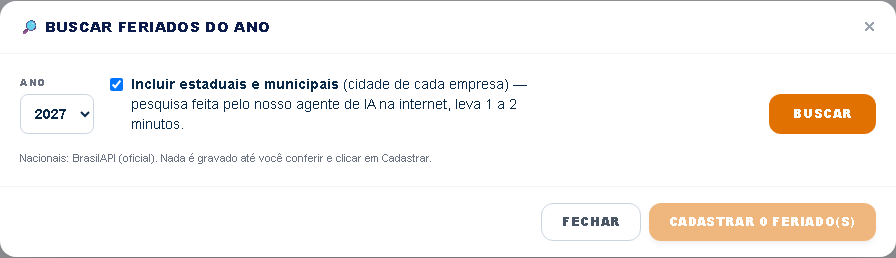
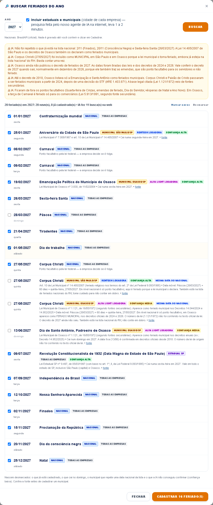

# Feriados

## Visão geral

**Onde fica:** RH → Parâmetros, aba **Feriados**.

Os dias cadastrados aqui são **carga zero** no ponto e na folha:

- Hora trabalhada num feriado paga como extra de domingo/feriado (ou diária, conforme o contrato) e o dia não gera falta.
- O lembrete de "sem ponto ontem" do WhatsApp não é enviado em feriado da empresa do funcionário.
- Espelhos de ponto e holerites **em aberto** se recalculam sozinhos quando um feriado entra, muda ou sai. Folhas já fechadas não mudam.

**Para quem vale cada feriado:**

| Tipo | "Aplica-se a" | Exemplo |
| --- | --- | --- |
| Nacional | Todas as empresas | Natal, Tiradentes |
| Estadual | Todas as empresas (as duas ficam em SP) | 9 de julho |
| Municipal | Só a empresa daquela cidade | 25/01 (São Paulo) só na Rentech; 19/02 (Osasco) só na Alfa Light |

O feriado municipal **precisa** ficar preso à empresa da cidade: a Rentech fica em São Paulo e a Alfa Light em Osasco, e o feriado de uma cidade não pode zerar a carga de quem trabalha na outra.

## Buscar os feriados do ano

O jeito mais rápido de montar o ano é o botão **🔎 Buscar feriados do ano**, acima do formulário de adicionar.

1. Escolha o **ano**. A partir de novembro, a tela já sugere o ano seguinte.
2. **Incluir estaduais e municipais** (marcado): além dos nacionais, o nosso agente de IA pesquisa na internet as leis do estado e da cidade de cada empresa. Leva de **1 a 2 minutos**. Desmarcado, vêm só os nacionais, na hora.
3. Clique em **Buscar**.

**De onde vêm os dados:**

- **Nacionais:** BrasilAPI, uma fonte pública e oficial. Ela já calcula os feriados móveis (Carnaval, Sexta-feira Santa, Corpus Christi).
- **Estaduais e municipais:** o agente de IA pesquisa nos sites da Prefeitura, da Câmara, da Assembleia Legislativa e no Diário Oficial. Cada feriado volta com a **lei**, o **link da fonte** e a **confiança**: alta (confirmado em fonte oficial), média (fonte secundária confiável) ou baixa (não confirmado).
- A cidade e a UF de cada empresa vêm de Parâmetros → Empresas. Empresa sem cidade fica sem a pesquisa municipal, e um aviso diz qual é.

## Conferir e cadastrar

Nada é gravado até você clicar em **Cadastrar**. A prévia mostra:

- **Avisos** da pesquisa no topo. Por exemplo: "Osasco ainda não publicou o decreto do ano; as datas vieram dos decretos anteriores".
- **Cada feriado:** data e dia da semana, o tipo (Nacional, Estadual ou Municipal com a cidade), para quem vale (Todas as empresas ou o selo da empresa), a lei, observações e o link **fonte**.
- **✓ Já cadastrado:** a data já está na tabela. A linha vem travada e mostra o nome que já existe (ex.: "Confraternização mundial → já cadastrado: ANO NOVO").

**Nascem desmarcados** (marque se quiser cadastrar):

- O que **já está cadastrado**.
- O que cai num **domingo** (Páscoa, por exemplo). Não muda o ponto de quem não trabalha no domingo.
- O **municipal que repete uma data nacional** da lista, com o selo "Mesma data do nacional". Cadastrar os dois não muda nada, porque o nacional já vale para todas as empresas.
- O que a IA **não conseguiu confirmar** (confiança baixa).

Confira o link **fonte** dos municipais antes de cadastrar, principalmente os de confiança média. Depois clique em **Cadastrar N feriado(s)**. A lista da aba se atualiza na hora. Os botões **Marcar novos** e **Desmarcar** ajudam a escolher.

**Carnaval e Corpus Christi:** pela lei federal são **ponto facultativo**, e a prévia avisa isso. A empresa decide se é folga. Se for, cadastre; se não for, desmarque. Corpus Christi é feriado municipal por lei em São Paulo e em Osasco.

**Custo:** cada busca com estaduais e municipais custa cerca de **US$ 0,50** (uns R$ 3) de uso da IA. A busca só dos nacionais é gratuita. Basta uma busca por ano. Vale repetir em dezembro, quando as prefeituras publicam os decretos do ano seguinte.

## Cadastrar, editar e excluir à mão

- **Adicionar:** data, descrição e **Aplica-se a** (Todas as empresas, ou a empresa da cidade), depois **+ Adicionar**. A empresa escolhida continua selecionada, para cadastrar vários seguidos.
- **Editar:** ✏️ na linha do feriado.
- **Excluir:** X na linha. O sistema pede confirmação, porque espelhos e holerites em aberto daquele dia voltam a ser dia útil.
- **Mesma data repetida:** a tabela não aceita a mesma data duas vezes para o mesmo alvo (todas, ou a mesma empresa).
- Quem só enxerga uma empresa (Parâmetros → Permissões) não cadastra feriado para "todas as empresas". A busca grava uma linha para cada empresa liberada para essa pessoa.

## Dúvidas comuns

- **A IA trouxe uma data que eu não conheço.** Abra o link **fonte** e confira a lei. Na dúvida, deixe desmarcado e pergunte à contabilidade.
- **A busca de estaduais e municipais deu erro.** Os nacionais continuam na prévia e o aviso diz o motivo (ex.: IA sem crédito ou fora do ar). Tente de novo mais tarde ou cadastre o municipal à mão.
- **Cadastrei um feriado errado.** Exclua na lista. Espelhos e holerites em aberto se recalculam. Folha já fechada não muda: fale com o RH para reabrir, se for o caso.
- **A empresa mudou de cidade.** Atualize a cidade em Parâmetros → Empresas antes de buscar.
