## Visão geral

Uma locação passa por cinco telas: a Ficha de Reserva (a OS), a Ficha de Locação (saídas e devoluções), o Faturamento (Nota de Débito), os Títulos a Receber e o Caixa. Cada tela é de uma área: Comercial, Operação e Financeiro.

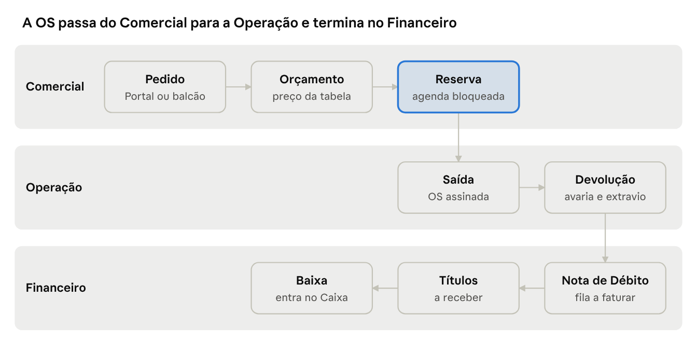

A reserva é o ponto de virada: só ela prende equipamento na agenda e libera a Operação. Orçamento perdido ou cancelado sai do fluxo antes dela; avaria e extravio da devolução viram títulos próprios.

As telas deste manual são do sistema real. Elas mostram um ciclo de exemplo feito em 23/11/2026 com um cliente fictício. Esse ciclo é ensaio e é cancelado em seguida pelo "Limpar o ensaio".

| Etapa | Quem faz | Onde fica | O que muda |
| --- | --- | --- | --- |
| 1. Cliente | Comercial | Comercial → Parceiros e Carteira | Cliente é um parceiro do cadastro (novo pelo sistema ou vindo do P2S); a carteira define o vendedor |
| 2. Pedido e orçamento | Comercial | Locações → Orçamentos e Reservas | Ficha nasce como Orçamento, com preço pela tabela |
| 3. Aprovação e reserva | Comercial | Mesma ficha → Aprovar e reservar | Equipamentos ficam reservados na agenda |
| 4. Saída do material | Operação | Locações → Fichas de Locação (ou Expedição) | Ficha de Locação FL-xxxxx/A; OS assinada na tela |
| 5. Retorno | Operação | Mesma Ficha de Locação → Devolução | Falta vira extravio com cobrança de reposição |
| 6. Faturamento | Financeiro | Financeiro → Faturamento | OS finalizada vira Nota de Débito e parcelas |
| 7. Cobrança e recebimento | Financeiro | Financeiro → Títulos a Receber e Caixa | Baixa do título entra no extrato da conta |

A ficha muda de status sozinha conforme a operação anda: Orçamento → Enviado → Aprovado → Reservada → Em locação → Finalizada. Perdido e Cancelada encerram o orçamento sem locação.

## 1. Cliente

O cliente da ficha é um parceiro do cadastro. Ele pode ser cadastrado aqui ou vir do P2S.

**Onde fica:** Comercial → Parceiros. A busca aceita nome, CNPJ, CPF ou cidade.

**Cliente novo:** botão **+ Novo cliente / fornecedor**. O CNPJ ou CPF é a chave: o sistema não deixa cadastrar o mesmo documento duas vezes. **Buscar na Receita** preenche os dados pelo CNPJ, e o CEP preenche o endereço. O passo a passo está no manual Cadastros do sistema.

**Cliente do P2S:** enquanto o P2S for oficial, o cadastro que veio de lá é só leitura aqui (altere no P2S). A sincronização roda às 11h e às 17h; para não esperar, use **Sincronizar agora**. Se o mesmo CPF/CNPJ for cadastrado nos dois lugares, a sincronização junta num cadastro só.

**Funcionário como cliente:** marque Cliente no painel Papéis comerciais da Ficha do RH. O CPF da ficha é a chave.

**O que conferir antes do orçamento:**

- **Razão social e CNPJ/CPF:** saem na proposta, no contrato e na Nota de Débito.
- **Endereço:** cidade e UF aparecem na ficha; a UF decide se a nota fiscal precisa de MDF-e (saída de SP).
- **E-mail:** é com ele que o cliente entra no Portal do Cliente.

**Carteira do vendedor:** cada cliente pode ter um vendedor responsável (Comercial → Carteira, ou no próprio cadastro do cliente). Quem é vendedor é marcado na Ficha do RH (painel Papéis comerciais). O vendedor só vê e atende os clientes da carteira dele. Um cliente sem carteira entra na carteira do vendedor da primeira ficha salva.

**Portal do Cliente:** o cliente entra em /cliente com o e-mail do cadastro e um código de 6 dígitos, que chega por e-mail e vale 10 minutos. Lá ele vê propostas, reservas e histórico, e pode pedir orçamento (próxima seção).

## 2. Pedido, orçamento e reserva

Todo pedido vira uma Ficha de Reserva (FR), que é a OS da locação. Ela nasce como Orçamento e só prende equipamento na agenda depois de **Aprovar e reservar**.

**Onde fica:** Locações → Orçamentos e Reservas.

### Como o pedido chega

- **Pelo Portal do Cliente:** o cliente preenche evento, local, datas e o que precisa, e clica em Enviar pedido de orçamento. Na lista de fichas aparece a faixa verde "pedido(s) de orçamento do Portal do Cliente". Em **Ver pedidos**, escolha a empresa e clique em **Converter em orçamento**. A ficha já nasce com cliente, contato, local e datas, e o texto do pedido fica nas Observações internas.
- **Por telefone, e-mail ou WhatsApp:** clique em **+ Novo orçamento** e preencha tudo à mão.

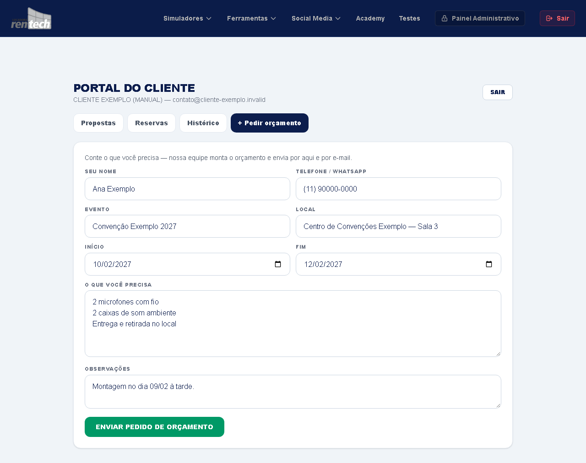

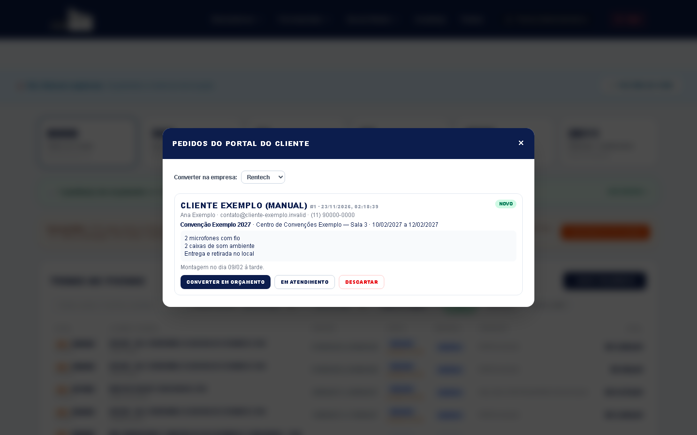

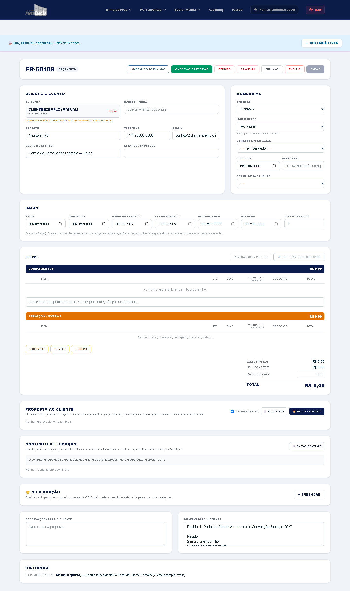

### Montar o orçamento

1. **Cliente e evento:** cliente (obrigatório), evento ou feira (opcional; evento novo é cadastrado em Comercial → Eventos e Feiras, botão + Novo evento), contato, telefone, e-mail, local de entrega e estande.
2. **Comercial:** empresa (Rentech ou Alfa Light), modalidade, vendedor da comissão, validade, condição e forma de pagamento.
   - **Por diária:** preço pelas faixas de dias da tabela.
   - **Período fechado:** a tabela sugere e o vendedor ajusta o valor do evento.
   - **Mensal:** valor mensal da tabela vezes os meses (cada 30 dias ou fração).
3. **Datas:** início e fim do evento são obrigatórios e definem os dias cobrados. Saída, montagem, desmontagem e retorno não entram no preço, mas prendem a agenda, junto com os dias de preparo e de retorno de cada equipamento.
4. **Equipamentos:** busque por nome, código ou categoria (kits também). O preço vem da tabela e a ficha mostra a conta, por exemplo "2 × R$ 150,00 + 1 × R$ 150,00 (diária da faixa)". Quantidade, valor e desconto podem ser editados em cada linha.
5. **Serviços e extras:** **+ Serviço**, **+ Frete** ou **+ Outro**, com descrição e valor.
6. **Verificar disponibilidade:** a tabela mostra, por equipamento, o período na agenda, quanto precisa, o estoque, o já reservado, o livre e a falta.
7. **Salvar.** O total aparece no rodapé dos itens, com desconto geral opcional.

Desconto acima do limite do usuário trava a ficha até alguém com alçada clicar em **Aprovar desconto**.

### Proposta e aprovação

- **Baixar PDF:** a proposta com itens, valores e condições; **Valor por item** decide se os preços aparecem linha a linha.
- **Enviar proposta:** manda para o cliente assinar pela Autentique. Quando ele assina, a ficha é aprovada e reservada sozinha.
- **Marcar como enviado:** use quando a proposta foi por outro meio.
- **Aprovar e reservar:** o sistema pede confirmação e reserva tudo para o período. Se faltar qualquer item, nada é reservado e aparece a lista de faltas.
- **Perdido** e **Cancelar** pedem o motivo. **Voltar a orçamento**, **Duplicar** e **Excluir** completam os botões; Excluir só aparece em ficha Orçamento, Enviado, Perdido ou Cancelada (ficha que teve movimento deve ser cancelada, não excluída).

### Depois de reservada

A ficha fica só com **Desfazer reserva**, **Cancelar** e **Duplicar** no topo, e ganha quatro blocos:

| Bloco | Para que serve |
| --- | --- |
| Contrato de locação | Baixar contrato ou Enviar contrato para assinatura (cliente e representante da locadora, pela Autentique) |
| Ficha de Locação | Abrir ficha de locação para a saída; Prorrogar o período |
| Sublocação | Pedir a parceiros o que falta no estoque |
| Faturamento | Faturar (Nota de Débito) ou Só gerar títulos |

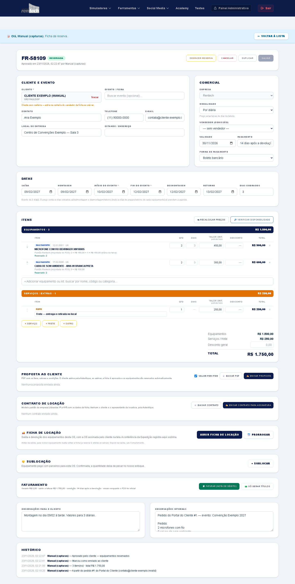

O Histórico, no pé da ficha, registra cada passo com data, hora e usuário.

## 3. Disponibilidade, agenda e sublocação

A agenda mostra, dia a dia, quanto sobra livre de cada equipamento. Ela soma as fichas aprovadas ou em locação importadas do P2S e as fichas reservadas aqui, com os dias de preparo e de retorno de cada produto.

**Onde fica:** Locações → Agenda de Disponibilidade.

- **Filtros:** empresa (Rentech ou Alfa Light), data inicial com ◀ ▶ e Hoje, período de 14, 30, 60 ou 90 dias, busca por equipamento, categoria, Só reservados e Só com falta.
- **Célula:** o número é o que sobra livre no dia. A cor sobe de "pouco uso" para 40%+, 75%+, esgotado (0) e falta (vermelho, negativo). Célula vazia é dia sem reserva.
- **Detalhe:** passe o mouse ou clique na célula para ver as fichas daquele dia, por exemplo "09/02/2027: 2 reservado(s) de 15 — 13 livre(s)".
- **Cartões do topo:** equipamentos com falta, equipamentos reservados, fichas no período e a hora da última importação do P2S (automática às 11h e às 17h).

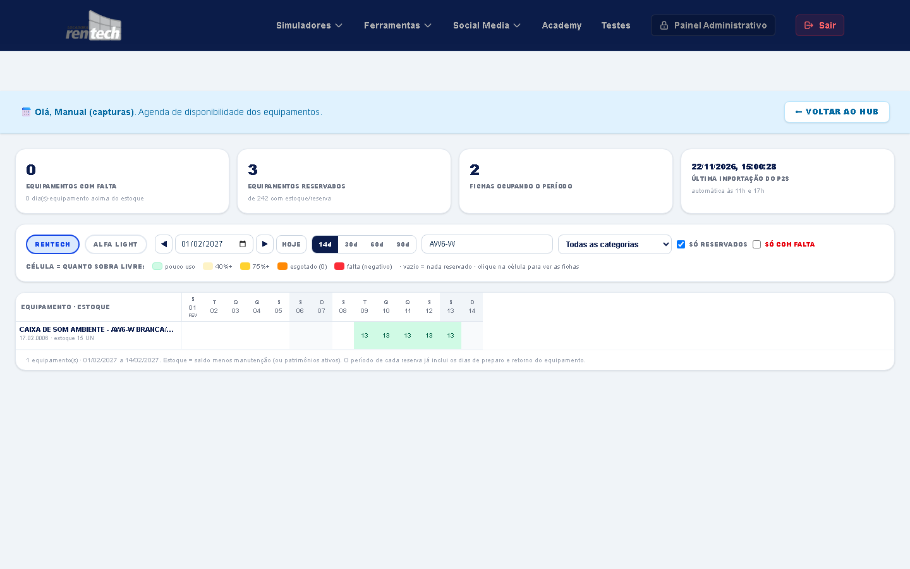

No exemplo, a ficha reservou 2 caixas de som de 09/02 a 13/02/2027, e a agenda mostra 13 livres de 15 nesses dias.

### Quando falta equipamento

A falta aparece em três lugares: no Verificar disponibilidade da ficha, na lista de faltas do Aprovar e reservar e em vermelho na agenda. Para cobrir, use a sublocação.

**Onde fica:** Locações → Sublocação, ou o botão **Sublocar o que falta** dentro da ficha.

- A sublocação registra o parceiro, os equipamentos, o período, o custo, a entrada (veio do parceiro) e a devolução (voltou para ele). A situação vai de Solicitada a Confirmada e fica Encerrada quando tudo foi devolvido.
- Confirmada pelo parceiro, a quantidade sublocada deixa de pesar no nosso estoque e a ficha pode ser reservada.
- O pagamento ao parceiro sai por OP já preenchida (sem OP, OP parcial, em OP, pago). A tela também mostra a margem da OS (receita do item × custo da sublocação). Os cartões mostram o que está com a gente agora e o que falta pagar fora de OP.
- A aba Ranking de parceiros e produtos mostra com quem e o que mais se subloca.

## 4. Saída do material

A saída é registrada na Ficha de Locação (FL), que nasce da OS reservada com o número da OS mais uma letra: FL-58109/A. Cada saída gera uma OS de saída assinada pelo cliente na tela.

**Onde fica:** na OS, bloco Ficha de Locação → **Abrir ficha de locação**. Depois, em Locações → Fichas de Locação.

### Aviso para a Expedição

Quando a OS é aprovada e reservada, a equipe recebe um push no app ("Nova OS para separar") e a OS entra no painel **OS para separar** da Expedição. Ela sai do painel quando um checklist importa os itens dela. A conferência do checklist registra a saída e o retorno na FL sozinha. O botão **OS para separação** da FL imprime a lista para separar.

### Registrar a saída pela ficha

1. Clique em **Registrar saída**.
2. Confira a data. Ela vai até hoje, nunca no futuro.
3. Clique em **Preencher tudo que está pendente**, ou digite a quantidade de cada item. Item controlado por patrimônio pede a leitura do QR da etiqueta (ou o número digitado).
4. Escreva uma observação, se precisar, e clique em **Registrar e colher assinatura**.
5. Entregue o celular ou tablet ao responsável do cliente. Ele confere a OS (Ver a OS antes de assinar), digita nome e documento (opcional) e assina na tela.
6. **Salvar e baixar OS** grava a assinatura e baixa o PDF. **Assinar depois** deixa a OS sem assinatura para colher mais tarde.

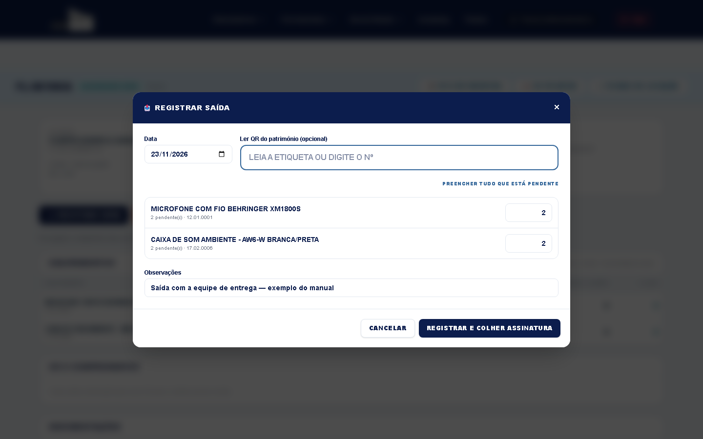

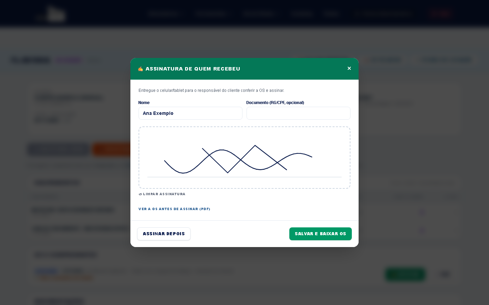

### O que a FL mostra

- **Topo:** cliente e CNPJ, evento e local, período com montagem e desmontagem, saída e devolução, contato e vendedor, e as fichas desta OS (/A, /B…).
- **Equipamentos:** previsto, saiu, voltou, extraviado, com o cliente e a sair.
- **OS e comprovantes:** cada OS de saída ou devolução, com data, usuário, observação, quem assinou e o PDF.
- **Movimentações:** cada linha de saída e entrada, com patrimônio quando houver.

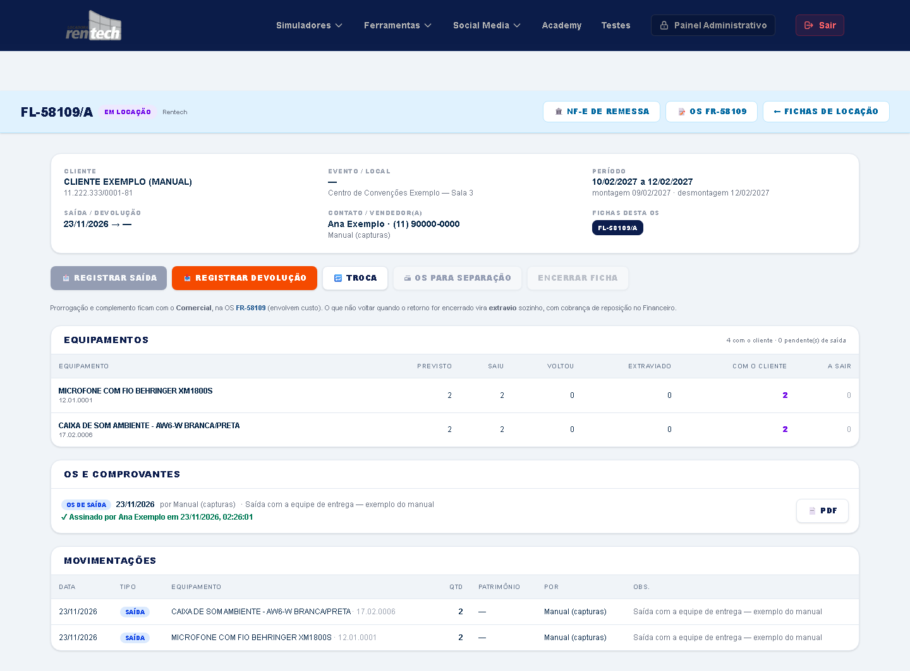

No exemplo, a saída de 2 microfones e 2 caixas foi registrada em 23/11/2026 e assinada por "Ana Exemplo"; a OS passou para **Em locação**.

### Durante a locação

- **Troca:** peça com defeito volta e outra sai, com motivo e gravidade da avaria.
- **Prorrogar** e **Complemento** ficam com o Comercial, na OS, porque mudam o valor. O complemento abre uma nova FL (/B).
- **NF-e de remessa:** abre o Fiscal (Financeiro → Fiscal) já preenchido com a FL. Se o destino for fora de SP, a nota pede MDF-e.

## 5. Retorno do material

O retorno é registrado na mesma Ficha de Locação, em **Registrar devolução**. Quando tudo volta e o retorno é encerrado, a FL e a OS ficam Finalizadas e a OS entra na fila do faturamento.

### Registrar a devolução

1. Clique em **Registrar devolução** e confira a data.
2. Clique em **Preencher tudo que está com o cliente**, ou digite o que voltou de cada item. Patrimônio é lido pelo QR.
3. Se algo voltou com problema, clique em **⚠ avaria** na linha do item e preencha:
   - quantidade (ou a peça, quando é patrimônio);
   - gravidade: Leve, Média, Grave ou Perda total;
   - o que aconteceu;
   - cobrança: a definir, cobrar do cliente ou não cobrar;
   - **abrir OS de manutenção**, que tira a peça do estoque até o conserto.
4. Marque **Devolução final — encerrar o retorno** quando não houver mais nada para voltar.
5. Clique em **Registrar e colher assinatura**. Quem entregou assina na tela, como na saída.

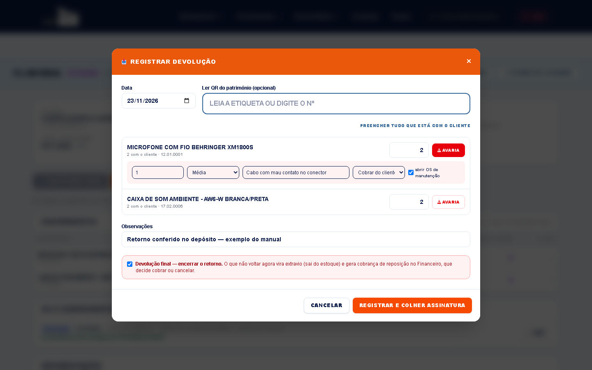

**Cuidado com a devolução final:** o que não voltou vira extravio, sai do estoque e gera uma cobrança de reposição no Financeiro. O Financeiro decide se cobra ou cancela.

No exemplo, voltaram as 2 caixas e os 2 microfones, um deles com o cabo com mau contato (avaria Média, cobrar do cliente, OS de manutenção aberta). A FL-58109/A ficou Finalizada, a OS FR-58109 também, e a avaria recebeu o número 7.

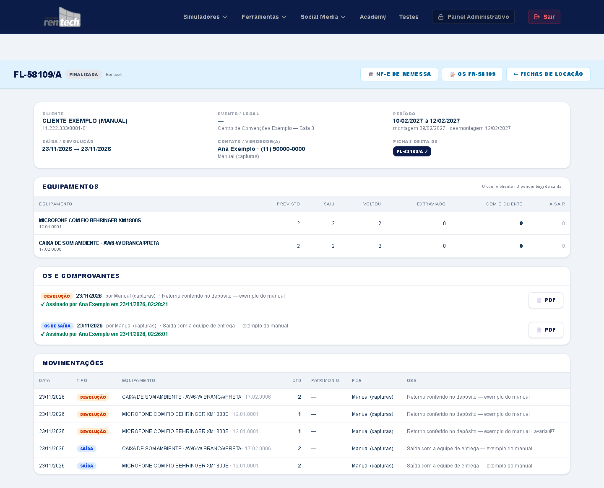

### Avarias e manutenção

**Onde fica:** Estoque → Avarias e Manutenção, abas **OS de manutenção** e **Avarias**.

- **Avarias:** lista com data, equipamento, gravidade, cliente e ficha, OS de manutenção, cobrança e valor. O filtro padrão mostra a cobrança pendente.
- **Abrir a avaria:** defina a cobrança (Cobrar, Não cobrar), o valor e uma observação, e salve. Com valor definido aparece **Gerar título a receber**.
- **OS de manutenção:** acompanha o conserto. Enquanto está aberta, a peça não conta como disponível na agenda.
- **Registrar avaria** e **+ Abrir OS** servem para casos fora de uma devolução.

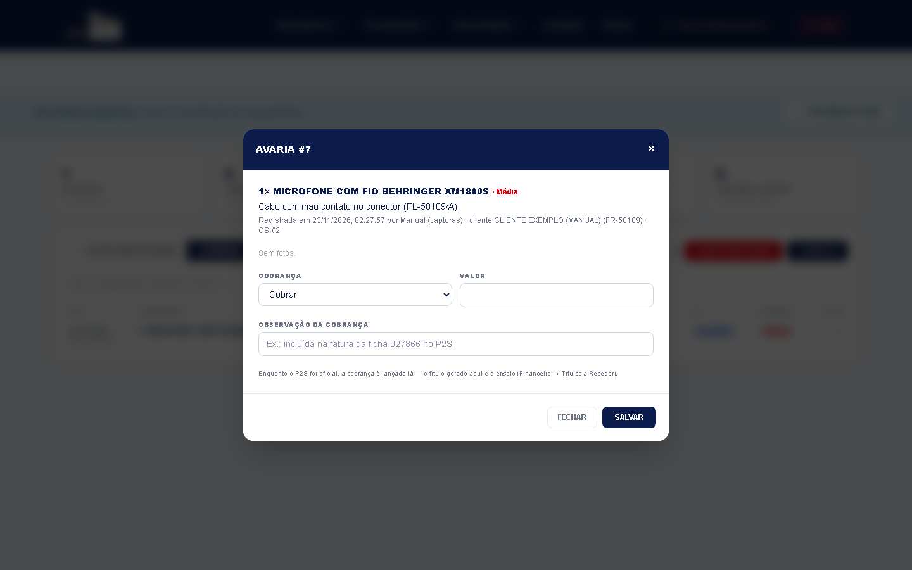

## 6. Faturamento

A OS é faturada depois da devolução, numa Nota de Débito com tudo junto: equipamentos, serviços, frete e prorrogações. A nota gera as parcelas em Títulos a Receber.

**Onde fica:** Financeiro → Faturamento. Também dá para começar pela OS, no bloco Faturamento.

### A fila "A faturar"

- Mostra as OS finalizadas que ainda têm saldo: OS, cliente e evento, período, data da devolução, total, já cobrado e a faturar.
- O saldo é o total da OS mais as prorrogações, menos os títulos já gerados para ela.
- **Incluir OS ainda em locação (antecipar)** traz também as que ainda não voltaram.
- Marque várias OS e use **Faturar em lote** para emitir todas com o mesmo prazo.

### Emitir a Nota de Débito

1. Clique em **Faturar** na linha da OS. O sistema mostra os itens e o saldo a faturar.
2. Escolha o número de parcelas (até 24), o 1º vencimento, o desconto em R$ e a forma (Transferência, PIX, Boleto, Depósito ou Cartão). A condição combinada na OS aparece embaixo para conferência.
3. Ajuste a data e o valor de cada parcela, se precisar.
4. Escreva as observações que saem na nota.
5. Clique em **Emitir Nota de Débito**.

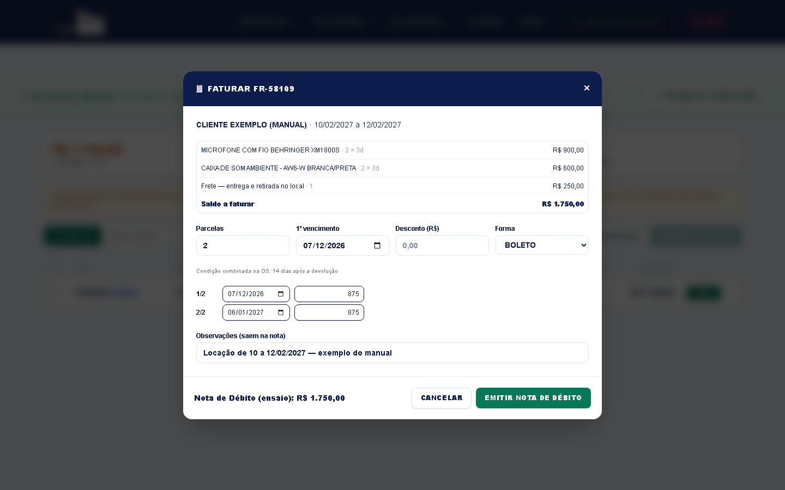

No exemplo, a FR-58109 virou a Nota de Débito ENS-0001, de R$ 1.750,00, em 2 parcelas de R$ 875,00 (07/12/2026 e 06/01/2027), no boleto.

### Notas emitidas

A aba **Notas emitidas** lista nota, emissão, cliente, OS, valor, situação e envio, com filtro de período e Excel. Em cada nota:

| Botão | O que faz |
| --- | --- |
| PDF | Baixa a Nota de Débito |
| e-mail | Manda o PDF anexo e o link para o cliente |
| WhatsApp | Abre a mensagem com o link da nota |
| link | Copia o link público da nota |
| NFS-e | Abre a emissão da nota fiscal de serviço (o Fiscal ainda está em homologação) |
| cancelar | Cancela a nota com motivo; as parcelas em aberto são canceladas e o saldo volta para a fila. Se alguma parcela já foi recebida, estorne o recebimento antes |

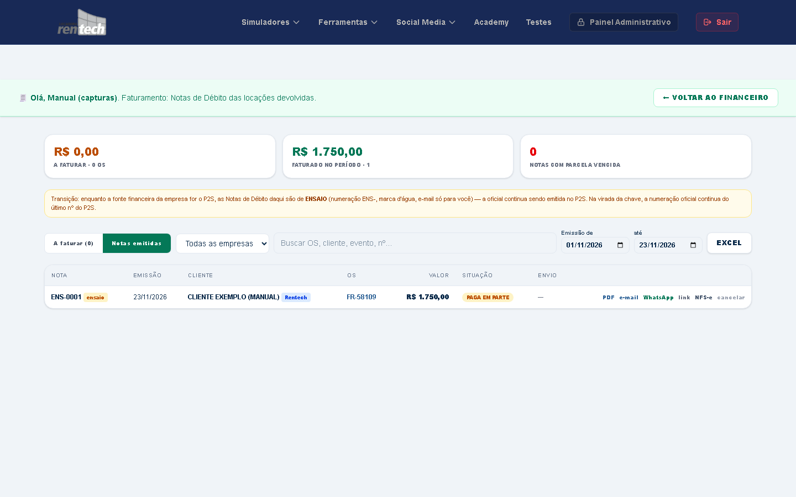

A situação acompanha as parcelas. Depois da baixa da 1ª parcela, a ENS-0001 ficou **Paga em parte**.

**Na fase paralela:** as Notas de Débito daqui são da série de ensaio (ENS-), com marca d'água, e o e-mail vai só para você. A nota oficial continua saindo do P2S. Na virada da chave, a numeração oficial continua do último número de Nota de Débito do P2S.

**Sem Nota de Débito:** o botão **Só gerar títulos**, na OS, cria as parcelas direto em Títulos a Receber.

## 7. Cobrança e recebimento

Cada valor a receber da locação é um título em Títulos a Receber, e o recebimento é a baixa desse título. Depois da virada da chave, a baixa também lança a entrada no Caixa.

**Onde fica:** Financeiro → Títulos a Receber.

### De onde vêm os títulos

| Origem | Como nasce |
| --- | --- |
| Fichas | Parcelas da Nota de Débito, ou do Só gerar títulos da OS |
| Avarias | Gerar título a receber, na avaria com cobrança e valor definidos |
| Reposição (não devolvido) | Extravio automático na devolução final |
| Avulsos | + Título avulso: empresa, cliente, descrição, valor, vencimento |

No exemplo ficaram três títulos: as duas parcelas de R$ 875,00 da ENS-0001 e a avaria nº 7, de R$ 80,00 com vencimento em 07/12/2026.

### A tela

- **Cartões:** a vencer, vencidos, em aberto e recebido no mês.
- **Filtros:** situação, origem, busca (cliente, descrição, ficha, número) e empresa. O botão Excel exporta a lista.
- **Em cada título:** Receber e Cancelar quando está em aberto; Estornar quando já foi recebido.

### Dar baixa (registrar o recebimento)

1. Clique em **Receber** na linha do título.
2. Confira a data do pagamento e o valor recebido.
3. Escolha a forma e informe juros/multa ou desconto, se houver.
4. Escreva uma observação, se precisar, e clique em **Confirmar recebimento**.

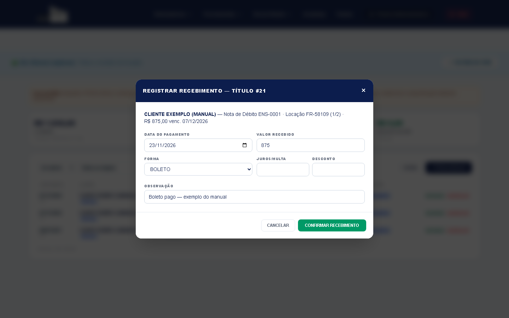

No exemplo, a parcela 1/2 (R$ 875,00) foi recebida em 23/11/2026 por boleto. O cartão "Recebido no mês" passou a R$ 875,00, a parcela saiu da lista de abertos e a Nota de Débito ficou Paga em parte.

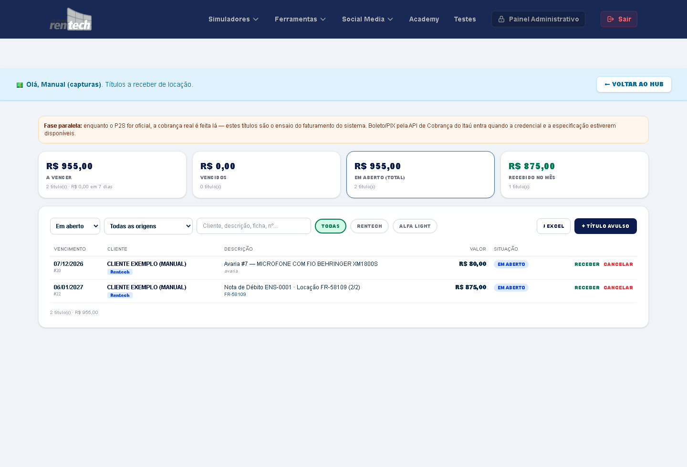

**Errou a baixa?** Use **Estornar**: o título volta para "em aberto". **Cancelar** pede motivo e serve para o que não será cobrado.

### Caixa e bancos

**Onde fica:** Financeiro → Caixa e Bancos, com saldo por conta, extrato, transferências e lançamentos avulsos.

Depois da virada, cada baixa entra no extrato como entrada na conta escolhida, ou na primeira conta bancária ativa da empresa. Na fase paralela a baixa fica só registrada, e o Caixa mostra os movimentos vindos do P2S.

**Na fase paralela:** a cobrança real é feita no P2S; os títulos daqui são o ensaio. O boleto com Pix pela API de Cobrança do Itaú entra quando o banco liberar a credencial e a especificação.

## 8. Portal do Cliente, indicadores e relatórios

O cliente acompanha a locação pelo Portal; a empresa acompanha pelos Indicadores de Utilização e pelos Relatórios.

### O que o cliente vê no Portal

| Aba | Conteúdo |
| --- | --- |
| Propostas | Orçamentos enviados, com o PDF para baixar (original e assinado) |
| Reservas | Locações aprovadas que ainda vão acontecer ou estão em andamento |
| Histórico | Locações concluídas, com período, local, empresa, valor e Detalhes |
| + Pedir orçamento | O formulário de pedido (seção 2) |

No exemplo, depois da devolução, a FR-58109 aparece no Histórico do cliente como **Concluída**, com R$ 1.750,00.

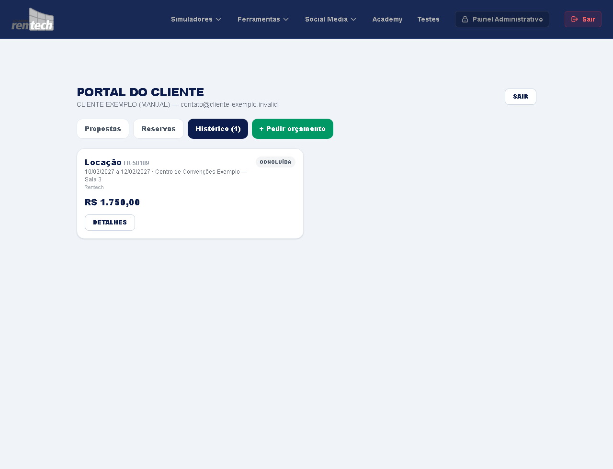

**Na fase paralela:** o Portal mostra só as fichas feitas no sistema, sem as do P2S, e ainda não mostra títulos. As duas coisas são ligadas na virada da chave.

### Indicadores de Utilização

**Onde fica:** Locações → Indicadores de Utilização.

Para cada equipamento, mostra estoque, número de locações, utilização, receita, receita por unidade e retorno sobre o valor do estoque, em 30 dias, 90 dias, 6 meses, 12 meses ou período livre. Os cartões destacam a utilização média, a receita, os itens de alta demanda (80% ou mais, candidatos a comprar), os ociosos e os locados sem estoque. Usa as fichas confirmadas do P2S e daqui.

### Relatórios

**Onde fica:** Painel → Relatórios.

| Relatório | Responde |
| --- | --- |
| Orçamentos e Conversão | Emitidos × aprovados × perdidos, conversão por vendedor, motivos de perda |
| Equipamentos e Operação | Mais e menos alugados, saídas e devoluções, devoluções atrasadas |
| Clientes (Curva ABC) | Ranking por receita, clientes novos, recompra e quem parou de alugar |
| Eventos e Feiras | Receita, OS e clientes por evento, comparando com a edição anterior |
| Comissão de Vendedores | Vendido × recebido e a comissão de cada vendedor |
| Faturamento | Notas de Débito emitidas, o que falta faturar e o prazo da devolução até a nota |
| Ocupação e Retorno | Ocupação do estoque, o que ficou parado e a receita sobre o valor do bem |
| Sublocação | Custo com parceiros, margem na OS e o que mais faltou |
| Avarias e Extravios | Ocorrências, custo de reposição e cobrado × recebido × perdoado |
| Financeiro | Recebido × pago, a receber, inadimplência por idade e maiores devedores |

## 9. Dúvidas frequentes e cuidados

**O que vale hoje, o sistema ou o P2S?** O P2S continua oficial até a virada da chave. O que é feito aqui é ensaio. As fichas do P2S chegam às 11h e às 17h (ou no botão Importar do P2S agora), aparecem com o selo P2S, só para leitura, e as aprovadas ou em locação ocupam a agenda.

**O que acontece com os testes antes da virada?** Antes de congelar o P2S, o Administrador usa **Limpar o ensaio** (Parâmetros → Virada da chave, Passo 1). Ele cancela as fichas, títulos, notas, avarias e OS de manutenção de teste, para não sujarem a agenda nem o financeiro.

**Cliente novo não aparece na busca.** Cadastre em Comercial → Parceiros (+ Novo cliente / fornecedor). Se ele foi cadastrado no P2S, clique em Sincronizar agora ou espere a sincronização das 11h ou das 17h. Se ele estiver na carteira de outro vendedor, só esse vendedor (ou quem vê todas) consegue atendê-lo.

**O cliente não recebe o código do Portal.** O e-mail dele precisa estar no cadastro da empresa. O código vale 10 minutos.

**Aprovar e reservar não reservou.** Faltou algum item no período; nada é reservado pela metade. Veja a lista de faltas, troque o item, mude as datas ou use Sublocar o que falta.

**A ficha não deixa enviar nem reservar.** Há desconto acima do seu limite esperando **Aprovar desconto** de quem tem alçada.

**Preciso mudar o pedido depois de reservado.** Antes da saída, edite a OS e salve; a reserva é refeita. Depois da saída, o Comercial usa **Complemento** (nova FL /B) ou **Prorrogar** na OS.

**A saída não aceita a data.** Saída e devolução não aceitam data futura; registre no dia em que o material sair.

**O cliente não pôde assinar na hora.** Use **Assinar depois**. O botão Assinar fica no comprovante, na lista OS e comprovantes da FL.

**Marquei devolução final com item faltando.** O que não voltou virou extravio e cobrança de reposição. O Financeiro pode cancelar essa cobrança em Títulos a Receber; a avaria fica como "não cobrar".

**Cancelar ou excluir uma ficha?** Excluir apaga de vez, com itens e histórico, e só aparece em Orçamento, Enviado, Perdido ou Cancelada. Ficha que teve reserva ou saída deve ser cancelada, com motivo, para manter o histórico.

**Preciso cancelar uma Nota de Débito com parcela paga.** Estorne o recebimento da parcela em Títulos a Receber e depois cancele a nota.
