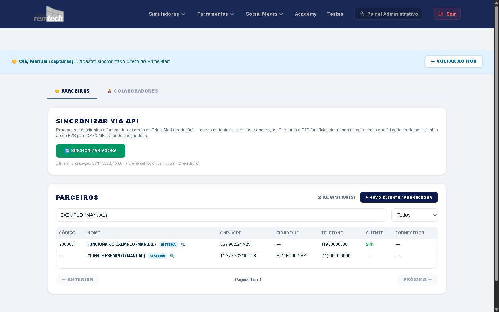
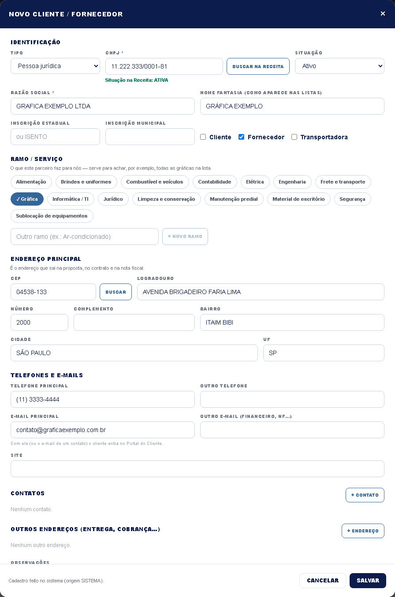
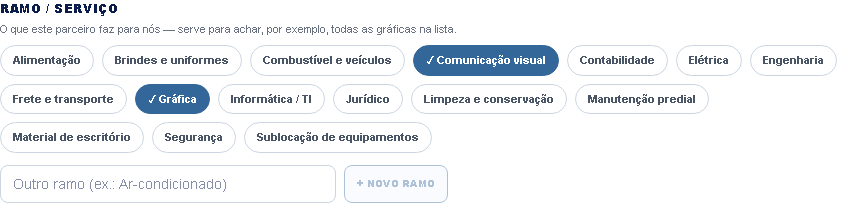
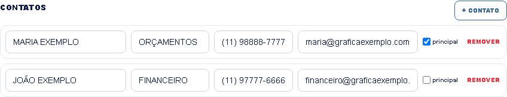
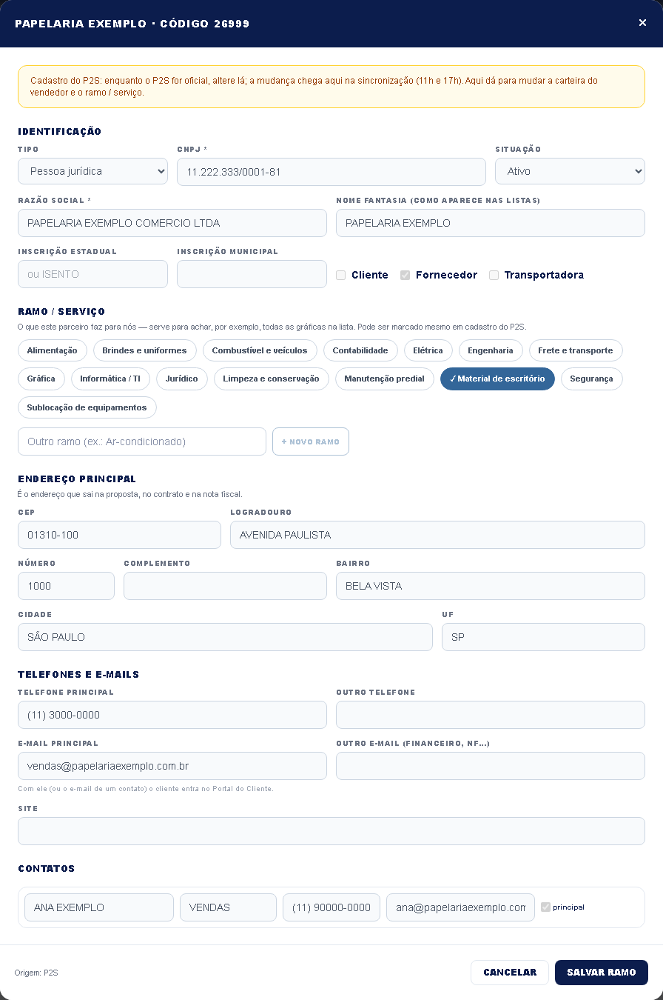

# Clientes e fornecedores (Parceiros)

## Visão geral

**Parceiro** é todo mundo com quem a empresa tem relação comercial: **clientes** (quem aluga), **fornecedores** (gráfica, engenheiro, papelaria, manutenção, sublocação…) e **transportadoras**. Um mesmo cadastro pode ter mais de um papel. Uma gráfica que também aluga equipamento, por exemplo, é cliente e fornecedor ao mesmo tempo.

O cadastro é **um só para a Rentech e a AlfaLight**, e o **CPF ou CNPJ é a chave**: não existem dois cadastros com o mesmo documento.

| Onde o cadastro é usado | Precisa estar marcado como |
| --- | --- |
| Reserva, proposta, contrato e nota fiscal (o endereço principal sai nos documentos) | Cliente |
| Portal do Cliente (entra com o e-mail do cadastro ou de um contato) | Cliente |
| Ordem de Pagamento e contas a pagar | Fornecedor |
| Sublocação (parceiro que nos aluga equipamento) | Fornecedor |
| Agenda de contatos: achar a gráfica, o engenheiro, a papelaria… | Fornecedor + Ramo / serviço |

As telas deste manual usam cadastros fictícios (GRÁFICA EXEMPLO, PAPELARIA EXEMPLO). Nada foi salvo para as fotos.

## Onde fica e como achar um parceiro

**Comercial → Parceiros**, aba **Parceiros**.

- **Busca:** por nome, nome fantasia, CNPJ, CPF ou cidade. Espaço vale como "qualquer coisa no meio": "EXEMPLO MANUAL" acha "EXEMPLO (MANUAL)". A busca diferencia acento: "GRAFICA" não acha "GRÁFICA". Na dúvida, busque um pedaço sem acento ("GRAF") ou use o filtro de ramo.
- **Filtro de papel:** Todos, Clientes ou Fornecedores.
- **Filtro de ramo:** ao lado do filtro de papel, "Todos os ramos" ou um ramo. Para achar as gráficas, escolha **Fornecedores** + **Gráfica**.
- **Em cada linha:** código, nome (com as etiquetas de ramo embaixo), CNPJ/CPF, cidade, telefone e o **contato principal** (nome e telefone), além de se é cliente e se é fornecedor.
- **Selo SISTEMA:** o cadastro foi feito aqui no sistema. Sem o selo, ele veio do P2S (ver "Cadastros que vieram do P2S").
- **Clicar na linha** abre o cadastro. A lupa 🔍 mostra todos os campos guardados, inclusive os que vieram do P2S.

## Cadastrar um fornecedor

Exemplo: uma gráfica nova.

1. Clique em **+ Novo cliente / fornecedor**.
2. **Tipo:** Pessoa jurídica (empresa) ou Pessoa física (um engenheiro autônomo, por exemplo).
3. **CNPJ ou CPF.** Ao sair do campo, o sistema avisa na hora se o documento já está cadastrado.
4. **Buscar na Receita** (só para CNPJ): preenche razão social, nome fantasia, endereço, telefone e e-mail, e mostra a situação na Receita. Se o CNPJ não estiver ATIVO, aparece um aviso em vermelho. Confira os dados antes de salvar.
5. Marque **Fornecedor** e desmarque **Cliente** se ele não for alugar com a gente.
6. **Ramo / serviço:** clique no ramo, por exemplo **Gráfica** (ver a seção "Ramo / serviço").
7. **Telefones e e-mails:** o telefone e o e-mail principais. Use "Outro e-mail" para o financeiro ou para a nota fiscal.
8. **Contatos:** as pessoas com quem você fala, como o atendente ou o responsável pelo orçamento (ver "Contatos e outros endereços").
9. **Salvar.** O cadastro ganha um código da faixa 900000 (os do P2S têm outra numeração) e o selo SISTEMA.

**Pessoa física** (engenheiro, eletricista, consultor autônomo): o CPF é obrigatório e precisa ser válido. Não existe "Buscar na Receita" para CPF, então preencha nome, telefone e endereço à mão.

## Cadastrar um cliente

O passo a passo é o mesmo, com três diferenças:

1. Deixe **Cliente** marcado. Só cliente aparece na busca da reserva.
2. **Endereço principal:** é o que sai na proposta, no contrato e na nota fiscal. Ao digitar o CEP e clicar em **Buscar**, o endereço vem sozinho.
3. **Carteira do vendedor:** escolha o vendedor responsável. O vendedor só vê e atende os clientes da carteira dele. Sem carteira, o cliente entra na carteira de quem fizer a primeira ficha.

O **e-mail principal**, ou o e-mail de um contato, é o que o cliente usa para entrar no **Portal do Cliente** e acompanhar as locações.

## Ramo / serviço

O ramo diz **o que o parceiro faz para nós**. Ele serve para montar a agenda de fornecedores: "quem são as gráficas?", "qual engenheiro já usamos?".

- Aparece no cadastro quando o parceiro é **fornecedor** ou **transportadora**.
- Clique para marcar e de novo para desmarcar. Pode marcar **mais de um** (uma gráfica que também faz brindes, por exemplo).
- **Ramo que não está na lista:** escreva no campo "Outro ramo" e clique em **+ Novo ramo**. Ele é criado e já fica marcado. Se o nome já existir, mesmo escrito com outras maiúsculas e minúsculas, o sistema reaproveita o ramo existente.
- **Ramos que já vêm na lista:** Alimentação, Brindes e uniformes, Combustível e veículos, Contabilidade, Elétrica, Engenharia, Frete e transporte, Gráfica, Informática / TI, Jurídico, Limpeza e conservação, Manutenção predial, Material de escritório, Segurança e Sublocação de equipamentos.

O ramo **pode ser marcado também nos cadastros que vieram do P2S**. A sincronização com o P2S não apaga o que você marcar.

## Contatos e outros endereços

**Contatos** (botão **+ Contato**): uma linha por pessoa, com nome, cargo ou área, telefone, e-mail e a marcação de **principal**. O principal é o que aparece na lista de Parceiros. Só um contato pode ser o principal: marcar outro desmarca o anterior.

**Outros endereços** (botão **+ Endereço**): entrega, cobrança, depósito…, cada um com tipo, endereço, cidade, UF, CEP e observação. O endereço principal continua sendo o da seção "Endereço principal".

**Observações:** texto livre no fim do cadastro, por exemplo "pedir orçamento com 3 dias de antecedência".

## Bloquear um parceiro

Em **Situação**, escolha **Bloqueado** e escreva o **motivo**, que é obrigatório. O cadastro continua existindo, com o histórico, e o motivo fica registrado para quem abrir o cadastro. Para desbloquear, volte para **Ativo**.

## Cadastros que vieram do P2S

Os parceiros cadastrados no P2S chegam ao sistema pela sincronização das **11h e 17h**, ou na hora pelo botão **Sincronizar agora** da mesma tela.

**Enquanto o P2S for oficial:**

- O cadastro do P2S fica **só para leitura**. Para mudar nome, documento, endereço, telefone ou contatos, altere no P2S. A mudança chega aqui na próxima sincronização.
- Mesmo assim, aqui dá para mudar a **carteira do vendedor** (clientes) e o **Ramo / serviço** (fornecedores). Nesses cadastros, o botão de salvar vira "Salvar ramo" ou "Salvar carteira e ramo".
- **Cadastrou aqui e depois alguém cadastrou o mesmo CPF/CNPJ no P2S?** A sincronização **adota** o cadastro daqui em vez de criar outro. Ele mantém o mesmo número e passa a seguir o P2S.

**Depois da virada da chave:** o sistema vira a origem de todos os cadastros, tudo pode ser editado aqui e a sincronização de parceiros para.

## Funcionário que é cliente ou fornecedor

Para marcar que um funcionário também é cliente ou fornecedor, use a **Ficha do Funcionário** (RH), no painel **💼 Papéis comerciais**, e não esta tela. O CPF da ficha é a chave: se já existe um parceiro com aquele CPF, ele é usado; se não existe, o sistema cria o cadastro com os dados da ficha. Detalhes no manual **Cadastros do sistema**.

## Dúvidas comuns

- **"Já existe um cadastro com este CNPJ/CPF".** O parceiro já está no sistema, com o nome e o código mostrados na mensagem. Feche, busque pelo documento na lista e edite o cadastro existente. Se ele for só cliente e agora também for fornecedor, marque **Fornecedor** nele.
- **Não consigo editar os campos.** O cadastro veio do P2S e o P2S ainda é oficial. Altere no P2S, ou mude só o ramo e a carteira aqui.
- **O cliente não aparece na reserva.** Confira se ele está marcado como **Cliente**.
- **A Receita não preencheu.** O serviço de consulta pode estar fora do ar. Preencha à mão e tente "Buscar na Receita" mais tarde, se quiser conferir.
- **O fornecedor não tem CNPJ** (autônomo). Cadastre como **Pessoa física**, com o CPF.
- **Quero ver todas as gráficas com telefone.** Na lista, escolha **Fornecedores** + o ramo **Gráfica**. O telefone e o contato principal aparecem na coluna Telefone.
