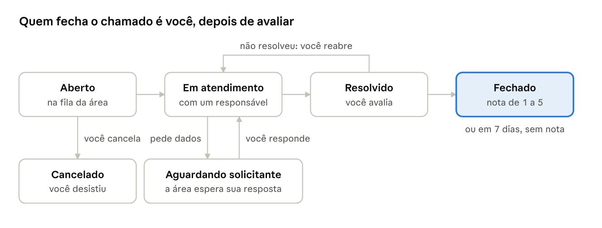

## O que é

A partir de agora, todo pedido de ajuda entre as áreas da empresa passa pelo **Suporte e Chamados**, dentro do sistema Rentech. Em vez de mandar mensagem solta no WhatsApp ou pedir no corredor, você abre um chamado e acompanha até a solução.

Você encontra o módulo no painel principal do sistema (rentech.tech/admin), no card **Suporte e Chamados**. Quando há novidade nos seus chamados, o card mostra um número em vermelho.

Áreas que atendem chamados hoje:

| Área | Para pedir ajuda com |
| --- | --- |
| TI | Acesso e senha, sistema Rentech, computador, e-mail, internet, impressora, celular |
| Financeiro | Pagamento e OP, reembolso, nota fiscal, boleto e cobrança |
| Operacional | Frota e veículos, logística, expedição, evento e montagem |
| RH | Ponto, holerite, benefícios, férias e afastamento, documentos |
| Estoque | Equipamento com defeito, manutenção, falta de material |
| Comercial | Proposta e orçamento, cliente, contrato, tabela de preço |

Cada chamado tem um número (por exemplo, #12). Use esse número quando falar do assunto com alguém.

## Como abrir um chamado

Leva menos de dois minutos. A área escolhida é avisada na hora.

1. No painel do sistema, clique no card **Suporte e Chamados**.
2. Clique em **+ Abrir chamado**.
3. Escolha a **área** que vai resolver o seu pedido. Na dúvida, escolha a mais próxima: a área pode transferir o chamado para quem for o certo.
4. Preencha o **assunto** em uma linha. Exemplo: "Impressora do comercial não imprime".
5. Escolha a **categoria**, se alguma combinar com o seu caso.
6. Escolha a **prioridade** (veja a próxima seção).
7. Se você trabalha para mais de uma empresa do grupo, marque a **empresa** (Rentech ou Alfa Light).
8. Escreva a **descrição**: o que aconteceu, desde quando, onde e o que você já tentou.
9. Se ajudar, clique em **Anexar arquivo** e envie prints, fotos ou PDF (até 20 MB cada, até 10 arquivos).
10. Clique em **Abrir chamado**. O número do chamado aparece na tela.

## Prioridade e prazo

A prioridade define o prazo que a área tem para resolver. Escolha pelo impacto no seu trabalho, não pela pressa.

| Prioridade | Quando usar | Prazo padrão |
| --- | --- | --- |
| Urgente | O trabalho está parado e não há alternativa (ex.: sistema fora do ar no dia do evento) | 4 horas |
| Alta | Atrapalha muito, mas dá para seguir de outro jeito por enquanto | 8 horas |
| Média | Problema ou pedido comum, sem prejuízo imediato | 24 horas |
| Baixa | Melhoria, dúvida ou pedido que pode esperar | 3 dias |

O prazo conta em horas corridas desde a abertura. Cada área pode ajustar os seus prazos, e o formulário sempre mostra o prazo real ao lado de cada prioridade.

A área pode mudar a prioridade depois de analisar o chamado. Use **Urgente** só quando for de fato urgente: se tudo for urgente, nada é.

## Como acompanhar

Você não precisa ficar olhando o sistema: quando a área responde ou muda o status, você recebe um aviso.

- **E-mail**, com um botão que abre o chamado direto.
- **WhatsApp**, no celular cadastrado na sua Ficha do Funcionário (RH).
- **App Rentech**, como notificação, se você usa o aplicativo.

No sistema, a aba **Meus chamados** lista tudo o que você abriu. Um ponto azul ao lado do chamado indica novidade que você ainda não viu. O filtro do topo separa os chamados em aberto, resolvidos e encerrados.

Para responder ou mandar mais informação, abra o chamado, escreva na caixa de mensagem no fim da conversa e clique em **Enviar**. Dá para anexar arquivos também. Se o chamado estiver como **Aguardando solicitante**, a área só continua depois da sua resposta.

O caminho de um chamado, do início ao fim:

Você também pode cancelar com o chamado em atendimento ou aguardando, enquanto ele não foi resolvido.

## Quando o chamado é resolvido

Quem fecha o chamado é você, não a área. Quando a área marca **Resolvido**, você recebe um aviso e confirma.

- **Resolveu?** Abra o chamado, dê uma nota de 1 a 5 estrelas (o comentário é opcional) e clique em **Confirmar e fechar**.
- **Não resolveu?** Clique em **Não resolveu — reabrir**, conte o que ainda falta e o chamado volta para a área.
- **Não respondeu?** Depois de 7 dias resolvido sem avaliação, o chamado fecha sozinho.

A nota é vista pela gestão e ajuda cada área a melhorar o atendimento.

Se você resolveu sozinho ou o pedido deixou de fazer sentido, use **Cancelar meu chamado** enquanto ele ainda está em aberto. Um chamado fechado ou cancelado não volta: se o problema aparecer de novo, abra um novo e cite o número antigo.

## Para quem atende uma área

Se você foi cadastrado como atendente de uma área, aparece a aba **Fila** com os chamados dela, ordenados por prioridade e prazo. Você recebe aviso a cada chamado novo, transferido ou respondido pelo solicitante.

No topo da fila, os quadros mostram o que pede atenção: **Sem responsável**, **Comigo** e **Atrasados**. Clique neles para filtrar.

Dentro do chamado, na coluna da direita:

| Ação | Para que serve |
| --- | --- |
| Assumir | Você vira o responsável e o solicitante é avisado |
| Responsável | Passa o chamado para outro atendente da área, que é avisado |
| Prioridade | Corrige a prioridade; o prazo é recalculado |
| Aguardar solicitante | Pede uma informação; a mensagem vai para o solicitante |
| Resolver | Marca como resolvido e conta o que foi feito; o solicitante confirma e avalia |
| Transferir | Manda o chamado para outra área, com o motivo |

Na caixa de mensagem há duas opções:

- **Responder**: o solicitante vê e é avisado. Responder um chamado sem responsável faz você assumi-lo.
- **Nota interna** (fundo amarelo): só a equipe da área vê. Use para combinar entre atendentes ou registrar o que foi tentado.

Regra de ouro: todo chamado precisa de uma resposta dentro do prazo, mesmo que seja "recebido, estou vendo".

## Dicas e perguntas frequentes

**Para o seu chamado ser resolvido mais rápido:**

- Um assunto por chamado. Dois problemas diferentes viram dois chamados.
- Assunto curto e claro: diga o que é, não "Ajuda" ou "Urgente".
- Na descrição, informe onde (máquina, sala, veículo, OS, cliente) e desde quando.
- Mande print da mensagem de erro ou foto do problema.
- Responda rápido quando a área pedir informação.

**Abri na área errada. E agora?** Não precisa abrir outro. A área transfere o chamado para a certa, e você recebe um aviso.

**Quem vê o meu chamado?** Você, os atendentes da área escolhida e a gestão do sistema. Outros colegas não veem.

**Não recebi o aviso pelo WhatsApp.** O WhatsApp vai para o celular da sua Ficha do Funcionário. Se ele estiver errado ou faltando, peça ao RH para atualizar. O aviso por e-mail e no sistema continua chegando.

**Abri um chamado para a minha própria área e não fui avisado.** O sistema não avisa a pessoa que abriu o chamado. Os outros atendentes da área são avisados normalmente.

**Posso ainda pedir pelo WhatsApp ou pessoalmente?** Para pedidos de trabalho, use o chamado. Assim nada se perde, tudo fica registrado e a área consegue organizar a fila.
